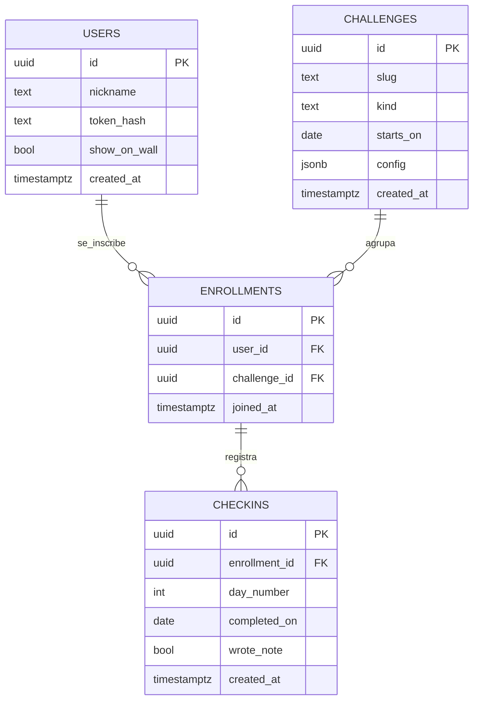

# 04 · Base de datos

Postgres en Supabase. Arquitectura, privacidad y operación general: [00-arquitectura.md](00-arquitectura.md). Reglas que originan las restricciones: [02-reto-7-dias.md](02-reto-7-dias.md) y [03-api.md](03-api.md).

> **Esta spec cubre la identidad y el reto de 7 días.** Las tablas de **peticiones de oración** pertenecen a una funcionalidad completamente distinta y se definen solo en [05-peticiones-de-oracion.md](05-peticiones-de-oracion.md). No se crean en el primer lanzamiento y no se relacionan con ninguna tabla del reto: lo único que comparten es `users`.

## 1. Principios

**Decidido**

| Decisión | Razón |
|---|---|
| **No existe tabla de grupos.** Hay una sola comunidad y se entra libremente, sin código de invitación | Una tabla `groups` con una sola fila no aporta nada. Si algún día hay varios grupos, se agrega la tabla y una columna `group_id` en una migración nueva (cambio aditivo y barato) |
| **No existe tabla de rachas.** Se guardan los check-ins como hechos y la racha (personal y del grupo) se deriva | Un contador guardado se desincroniza y no deja corregir errores. Recalcular es barato a esta escala |
| **Modelo de retos genérico** (`challenges` con `kind` y `config`, `enrollments`) | Sirve a cualquier reto futuro. Cada tipo de reto trae su propia tabla de hechos cuando exista (`checkins` es la del tipo `daily_steps`) |
| **La inscripción se crea con el primer día completado** | Solo cuenta como inscrito quien participó al menos un día ([02 §4](02-reto-7-dias.md)). Registrarse con un nickname crea `users`, no `enrollments` |
| **El contenido de cada día vive en el front.** La base solo guarda estado | Los textos se corrigen sin migraciones ([02 §2](02-reto-7-dias.md)) |
| **Nunca se guarda el texto de las conversaciones ni la firma** | Dato íntimo/sensible ([00 §3](00-arquitectura.md)). De «escribió» solo queda un booleano |
| **El mínimo de datos personales: solo el nickname.** No se guarda nombre de pila ni contraseña | Menos dato sensible (en el grupo hay menores de edad); el muro funciona con nickname |
| **Del token solo se guarda el hash** | Un volcado o filtración no permite hacerse pasar por nadie |

## 2. Diagrama entidad-relación (primer lanzamiento)



## 3. Tablas

| Tabla | Columnas | Notas |
|---|---|---|
| `users` | `id`, `nickname`, `token_hash`, `show_on_wall`, `created_at` | Se crea al registrarse (al «firmar» el compromiso). `nickname` único, guardado siempre en minúsculas, 3 a 7 caracteres. Un solo token por cuenta. `show_on_wall` por defecto `true` |
| `challenges` | `id`, `slug`, `kind`, `starts_on`, `config` (jsonb), `created_at` | `kind` indica el tipo de reto (hoy solo `daily_steps`). `starts_on` es nulo para tipos sin fecha de inicio |
| `enrollments` | `id`, `user_id`, `challenge_id`, `joined_at` | Una inscripción por persona y reto. **Se crea junto con el primer check-in**, en la misma transacción. `joined_at` es también el registro de cuándo la persona aceptó el aviso de privacidad |
| `checkins` | `id`, `enrollment_id`, `day_number`, `completed_on`, `wrote_note`, `created_at` | Tabla de hechos del tipo `daily_steps`. Único por inscripción y número de día. `created_at` es cuándo se marcó, con hora |

### Qué guarda `config`

`config` es para lo propio de cada tipo de reto. Para `daily_steps`:

| Clave | Significado | Estado |
|---|---|---|
| `total_days` | Cantidad de días del reto (p. ej. 7). **Obligatoria**, entera y mayor que 0 | Decidido |
| `group_streak_threshold` | Fracción (0 a 1) de personas inscritas que debe completar un día para que cuente en la racha del grupo | Decidido. Para el primer reto: `0.6` (60 %) |

Otro tipo de reto (p. ej. un quiz con puntaje máximo) definiría sus propias claves y, cuando exista, su propia tabla de hechos (por ejemplo, intentos con puntaje). Conviene documentar las claves de cada `kind` en el repositorio para que `config` no se convierta en un cajón de sastre. La base valida lo esencial de `daily_steps` (`total_days` positivo y `starts_on` presente); el resto lo valida la API.

### Primer reto (datos de siembra)

| Campo | Valor |
|---|---|
| `slug` | `oracion-7-dias` (pendiente unificar con la ruta del front, ver [01 §4](01-pagina-principal.md)) |
| `kind` | `daily_steps` |
| `starts_on` | `2026-11-14` (sábado; el día 7 es el viernes `2026-11-20`) |
| `config` | `{ "total_days": 7, "group_streak_threshold": 0.6 }` |

## 4. Restricciones e índices que se desprenden de las reglas

| Regla | Mecanismo |
|---|---|
| Nickname único (sin distinguir mayúsculas) | La API lo guarda siempre en minúsculas y un `CHECK` lo exige, así que basta un único simple sobre `nickname` |
| Autenticar por token con una búsqueda | `users.token_hash` **único** (sirve también de índice) |
| Un reto por slug | `challenges.slug` único |
| Reto `daily_steps` bien formado | `CHECK`: `total_days` entero > 0 y `starts_on` no nulo cuando `kind = 'daily_steps'` |
| Una inscripción por persona y reto | Único `(user_id, challenge_id)`. Con la inscripción implícita, el primer check-in hace *upsert* de la inscripción: dos pulsaciones simultáneas no crean dos |
| **Un check-in por inscripción y día** | Único `(enrollment_id, day_number)`: hace seguros los reintentos y las dobles pulsaciones |
| Día dentro de rango | `CHECK (day_number >= 1)`; el límite superior (`total_days`) vive en `config`, así que lo valida la API (o un trigger, si se quiere doble protección) |
| Solo se completa el día de hoy | Lo valida la API (depende de la fecha de Bogotá). Como consecuencia, `completed_on` siempre es `starts_on + day_number − 1` |
| Muro por defecto visible | `show_on_wall boolean NOT NULL DEFAULT true` |
| Consultas del muro y del río | Índice en `enrollments(challenge_id)`; `checkins(enrollment_id)` ya lo cubre el único compuesto |
| Formato de nickname | Validación en la API (incluido el filtro de vulgaridades, [03 §5](03-api.md)); en la base, `CHECK` con la expresión `^[a-z0-9_]{3,7}$` como red de seguridad |
| Borrado de cuenta | `ON DELETE CASCADE` desde `users` hacia `enrollments` y desde estas hacia `checkins`: un borrado de usuario limpia todo. Así se libera un nickname |
| Borrado de reto | `ON DELETE RESTRICT` desde `challenges`: no se puede borrar un reto que tenga inscripciones sin borrarlas antes a propósito. Protege contra un borrado accidental |

Los tipos `uuid` con `gen_random_uuid()` como valor por defecto, `timestamptz` para instantes y `date` para días de calendario. `starts_on` y `completed_on` son `date` en la zona de Bogotá: la API las calcula, la base no las interpreta.

### Esquema de referencia (`0001_init.sql`)

Punto de partida para la primera migración, sacado de las tablas y restricciones de arriba. Está escrito para Postgres 15 o superior (el de Supabase), donde `gen_random_uuid()` viene incluido. Se puede ajustar al implementar; lo que no debe cambiar son las restricciones, porque de ellas dependen las reglas del reto.

```sql
create table users (
  id           uuid primary key default gen_random_uuid(),
  nickname     text not null unique
               check (nickname ~ '^[a-z0-9_]{3,7}$'),
  token_hash   bytea not null unique
               check (octet_length(token_hash) = 32),      -- SHA-256
  show_on_wall boolean not null default true,
  created_at   timestamptz not null default now()
);

create table challenges (
  id         uuid primary key default gen_random_uuid(),
  slug       text not null unique,
  kind       text not null,
  starts_on  date,
  config     jsonb not null default '{}'::jsonb,
  created_at timestamptz not null default now(),
  -- daily_steps: starts_on obligatorio y total_days entero > 0.
  -- Se usa CASE porque Postgres no garantiza el orden de evaluación de AND.
  constraint daily_steps_valid check (
    case when kind = 'daily_steps' then
      starts_on is not null
      and case when jsonb_typeof(config -> 'total_days') = 'number'
               then (config ->> 'total_days')::numeric > 0
                and (config ->> 'total_days')::numeric
                    = trunc((config ->> 'total_days')::numeric)
               else false end
    else true end
  )
);

create table enrollments (
  id           uuid primary key default gen_random_uuid(),
  user_id      uuid not null references users (id) on delete cascade,
  challenge_id uuid not null references challenges (id) on delete restrict,
  joined_at    timestamptz not null default now(),
  unique (user_id, challenge_id)
);
create index enrollments_challenge_id_idx on enrollments (challenge_id);

create table checkins (
  id            uuid primary key default gen_random_uuid(),
  enrollment_id uuid not null references enrollments (id) on delete cascade,
  day_number    int  not null check (day_number >= 1),
  completed_on  date not null,
  wrote_note    boolean not null default false,
  created_at    timestamptz not null default now(),
  unique (enrollment_id, day_number)
);

-- Nadie debe usar la API automática de Supabase: RLS activo y sin políticas.
alter table users       enable row level security;
alter table challenges  enable row level security;
alter table enrollments enable row level security;
alter table checkins    enable row level security;
```

Siembra del primer reto, en un script o migración de datos aparte:

```sql
insert into challenges (slug, kind, starts_on, config)
values ('oracion-7-dias', 'daily_steps', '2026-11-14',
        '{"total_days": 7, "group_streak_threshold": 0.6}');
```

Notas para quien la implemente:

- **El rol que usa la API** debe poder saltarse RLS (el dueño de las tablas lo hace por defecto) o tener políticas propias; si no, la API tampoco verá filas. Con un rol dedicado distinto del dueño, hay que darle permisos y `bypassrls` o crear políticas para él.
- **Inscripción implícita:** el primer check-in hace `insert … on conflict (user_id, challenge_id) do nothing` en `enrollments`, lee el `id` y luego hace el *upsert* del check-in (`on conflict (enrollment_id, day_number) do update set wrote_note = excluded.wrote_note`), todo en una transacción.
- **Si se decide recuperar cuentas por nickname** (decisión abierta en [00 §3](00-arquitectura.md)), el esquema no cambia: se reemplaza `token_hash` y el token anterior deja de valer.
- **Para probar el día bloqueado y las rachas** sin esperar días reales, sembrar en local un reto de prueba con otro `slug` y un `starts_on` en el pasado, o permitir en desarrollo fijar «hoy» con una variable de entorno (nunca en producción).

## 5. Migraciones

**Decidido:** versionadas en el repositorio.

**Recomendado**

- Carpeta `backend/migrations/`, un archivo SQL numerado por cambio (`0001_init.sql`, `0002_...`), nunca editar uno ya aplicado: se agrega uno nuevo.
- Una herramienta pequeña que lleve el registro de versiones (por ejemplo `goose` o `golang-migrate`); la elección es abierta y sin consecuencias grandes.
- Mismas migraciones en el Postgres local y en Supabase. Aplicarlas manualmente al inicio es suficiente; automatizarlas en CI es una mejora.
- Los datos iniciales (el primer reto, §3) se siembran con un script o una migración de datos explícita, no mezclados con la de esquema.
- La migración inicial contiene **solo** las tablas del reto y de identidad. Las tablas de peticiones de oración, si algún día se construyen, irán en su propia migración ([05](05-peticiones-de-oracion.md)).
- Cambio previsto, aditivo: tabla de grupos si algún día hay más de uno.

**Abierto:** herramienta de migraciones concreta.

## 6. Notas de operación

(Detalle y razones en [00 §4](00-arquitectura.md).)

| Tema | Nota |
|---|---|
| **Pausa por inactividad** | Supabase pausa el proyecto tras 7 días sin peticiones a la base. Un cron (GitHub Action) llama cada 2–3 días a `GET /v1/health`, que ejecuta una consulta |
| **Backups** | Son nuestros: `pg_dump` programado. El volcado contiene nicknames e historial de participación → guardarlo en privado y con retención corta; probar restaurar |
| **Pooler** | La API se conecta por el pooler de Supabase. Con el modo transacción, evitar sentencias preparadas persistentes en el driver. Migraciones y volcados: modo sesión |
| **Zona geográfica** | Base y API en la misma zona |
| **Esquema expuesto** | Activar RLS en todas las tablas sin políticas (o desactivar la API automática de Supabase): el front nunca debe consultar la base |
| **Desarrollo** | Postgres local, mismas migraciones. No se crea otro proyecto de Supabase |
| **Tamaño** | ~50 personas × pocos check-ins: la base es diminuta; el límite relevante no es almacenamiento sino la pausa por inactividad |

## 7. Fuera de alcance por ahora

- Tablas de **peticiones de oración** (funcionalidad aparte, [05](05-peticiones-de-oracion.md)).
- Tabla de grupos y código de invitación.
- Código de recuperación de cuenta (decidido no implementarlo por ahora; si cambia, sería una columna nullable en `users`).
- Tabla de rachas, vistas materializadas o cachés de rachas.
- Nombre de pila, contraseña o cualquier otro dato personal además del nickname.
- Tabla para «enviar ánimo» (hay que definirla cuando se aborde).
- Tablas de otros tipos de reto (quiz con puntaje, etc.).
- Auditoría de moderación, historial de cambios.
- Almacenar contenido de conversaciones, firmas o archivos.
- Réplicas, particionado, multi-región.
