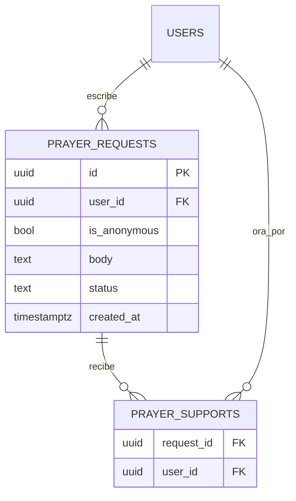

# 05 · Peticiones de oración

> **Esta es una funcionalidad completamente distinta del reto de 7 días.** Tiene su propio alcance, su propia página, sus propias tablas, sus propios endpoints y su propio lanzamiento, **posterior** al del reto. No forma parte de [02-reto-7-dias.md](02-reto-7-dias.md) ni depende de él, ni él de esta. Lo único que comparten es la identidad (nickname y token, tabla `users`). Que el día 6 del reto se llame «Orar por otros» no las conecta: si en el futuro se quisiera enlazarlas, sería una decisión nueva.
>
> Todo lo de peticiones está **en esta spec y solo aquí**: tablas (§4), endpoints (§3) y reglas. Las specs de la API ([03](03-api.md)) y de la base ([04](04-base-de-datos.md)) cubren la identidad y el reto, y remiten aquí.

Identidad y privacidad: [00-arquitectura.md §3](00-arquitectura.md).

## 1. Por qué es una funcionalidad separada

Las peticiones son lo que tiene más riesgo de todo el proyecto: moderación, anonimato y contenido delicado (salud, familia, crisis). El reto, en cambio, solo guarda «el día se completó». Mezclarlos haría que un problema de moderación frenara el reto. Por eso:

- Comparten solo la **identidad** (nickname y token).
- Se lanzan por separado, y **después** del reto.
- No comparten tablas con el reto (solo `users`).
- En la API van en un módulo propio, separado del reto ([03 §9](03-api.md)).

**Decidido:** las peticiones quedan fuera del primer lanzamiento. *Razón:* el riesgo descrito.

## 2. Qué es (el comportamiento propuesto)

Personas del grupo publican peticiones de oración; otras indican «estoy orando» (un contador, sin comentarios). El estado y la moderación los gestionan los líderes.

Lo **ya definido** viene del planteamiento de la funcionalidad; lo demás es una propuesta que puede cambiar.

### Recomendado

| Tema | Propuesta | Razón |
|---|---|---|
| Interacción | Un contador de «estoy orando», **sin comentarios** | Menos moderación y menos riesgo de consejos o juicios fuera de lugar |
| Límites | Límite de caracteres por petición (propuesta: 500) y de publicaciones por día | Frena abuso y mantiene las peticiones legibles |
| Moderación | Los líderes pueden ocultar o borrar | Contenido delicado |
| Casos delicados | Definir **quién revisa** las peticiones sensibles | Hay peticiones que requieren trato pastoral, no solo moderación |
| Autoría | Guardar el autor (`user_id`, que solo tiene nickname, sin nombre) internamente aunque la petición sea anónima | Permite que la persona borre la suya y manejar abusos |
| Anonimato | **Anónima = anónima para el grupo**, y así se dice en pantalla | No prometer un anonimato que la base no ofrece |

### Abierto

| Pregunta | Nota |
|---|---|
| ¿La ven todos o solo los líderes? | Cambia el endpoint de lectura y la propuesta de moderación |
| ¿Anónima para el grupo o anonimato total? | Con anonimato total no hay autor en la base: nadie puede borrar su petición ni se puede identificar abuso |
| Valores de `status` y flujo de moderación | Candidatos (propuesta): `active` / `hidden` / `archived` |
| En el grupo **hay menores de edad**: ¿pueden publicar? | Aquí sí se guarda texto libre, a diferencia del reto |
| ¿Se permite ver peticiones antiguas o solo las activas? ¿Cuánto duran? | |
| ¿Hay un tope de «estoy orando» por persona/petición, y se puede retirar? | Se propone un solo apoyo por persona y petición (clave `request_id + user_id`) |
| Idea para más adelante: peticiones respondidas que se vuelven testimonio | No definida |

## 3. API prevista

Rutas propias, separadas de las del reto. Ninguna existe en el primer lanzamiento.

| Ruta | Quién | Propósito |
|---|---|---|
| `GET /v1/prayer-requests` | Miembro (o solo líder, según la pregunta abierta) | Listar peticiones visibles; incluye contador de «estoy orando» |
| `POST /v1/prayer-requests` | Miembro | Publicar `{ body, is_anonymous }` |
| `DELETE /v1/prayer-requests/{id}` | Su autor | Borrar la propia |
| `PUT/DELETE /v1/prayer-requests/{id}/support` | Miembro | Agregar o retirar «estoy orando» |
| `GET /v1/admin/prayer-requests`, `PATCH /v1/admin/prayer-requests/{id}` | Líder (clave admin) | Revisar y ocultar peticiones |

Reglas de dominio propuestas: máximo de caracteres por petición, máximo de peticiones por persona y por día, rate limit propio, y que una petición anónima **nunca** devuelva el autor al grupo.

## 4. Datos

Tablas propias, en una migración aparte de la del reto. Solo se conectan con `users`; no con `challenges`, `enrollments` ni `checkins`.

| Tabla | Columnas | Notas |
|---|---|---|
| `prayer_requests` | `id`, `user_id`, `is_anonymous`, `body`, `status`, `created_at` | `created_at` necesario para límite por día y orden |
| `prayer_supports` | `request_id`, `user_id` | El «estoy orando». Clave única `(request_id, user_id)` |

| Decisión | Detalle |
|---|---|
| **«Anónima» = anónima para el grupo** | Así debe decirse en pantalla. La base **conoce** al autor (su `user_id`; solo el nickname, nunca un nombre) |
| **Recomendado: guardar el autor** aunque sea anónima | Permite que la persona borre su petición y permite manejar abusos |
| **Alternativa: anonimato total** (sin autor en la base) | Pierde esas dos cosas. Requiere `user_id` nullable, siempre `NULL` para las anónimas (o para todas), y sin `ON DELETE CASCADE` para ellas porque no habrá a quién enlazarlas |
| **Abierto** | La decisión entre ambas |

## 5. Privacidad

- **A diferencia del reto, aquí el servidor sí guarda texto libre** (el cuerpo de la petición). Eso cambia el aviso de privacidad y exige más cuidado: las peticiones pueden revelar salud, familia, convicciones (dato sensible, Ley 1581 de 2012), y en el grupo hay menores de edad. Como `users` solo guarda un nickname, el vínculo con una persona real es débil, pero un texto libre puede delatar por sí solo a quien lo escribe.
- Al borrar la cuenta, sus peticiones se borran (recomendado), salvo que se decida anonimato total, caso en que no hay a quién enlazarlas.
- Las peticiones no deben aparecer en los registros del servidor, y los volcados de respaldo que las contengan deben guardarse en privado ([00 §4](00-arquitectura.md)).

## 6. Dónde vive en el front

**Abierto:** ruta (propuesta `/peticiones`) y si lleva enlace en la navegación de la página principal. No se diseña en el PDF actual, por lo que esta spec no describe pantallas. No se enlaza desde la página del reto.

## 7. Fuera de alcance por ahora

- **Toda la funcionalidad**: no entra en el primer lanzamiento.
- Comentarios o respuestas a las peticiones.
- Notificaciones («alguien oró por ti»).
- Peticiones privadas entre dos personas o mensajería.
- Panel de líderes visual.
- Conexión con el reto de 7 días.
