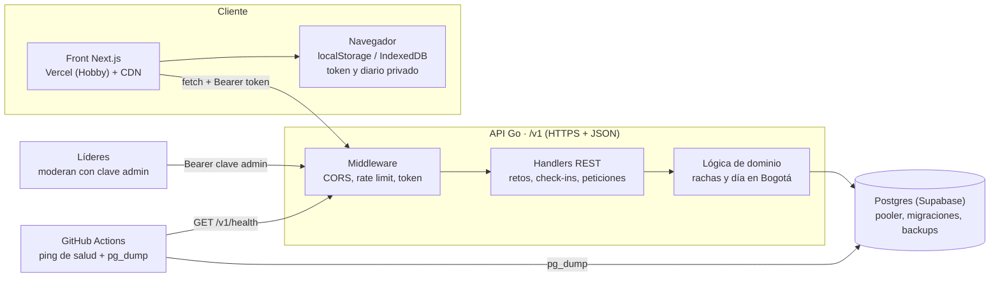

# 00 · Arquitectura

Visión general, decisiones transversales y despliegue. Las demás specs remiten aquí para identidad, privacidad y operación.

> Cómo leer esto: cada sección separa lo **Decidido** (con su razón), lo **Recomendado** (se puede cambiar con criterio) y lo **Abierto** (falta decidir). Si encuentras algo mejor que lo recomendado, apártate y deja anotado por qué.

## 1. Punto de partida (lo que hay hoy en el repo)

| Aspecto | Hoy |
|---|---|
| Framework | Next.js 16 (App Router) + React 19 + TypeScript + Tailwind 4, gestionado con pnpm |
| Rutas | Solo `/` (`src/app/page.tsx`), que monta `PassportApp` (la actividad «Cédula del Cielo») |
| Estado | Solo en el dispositivo: IndexedDB mediante `src/hooks/use-passport-storage.ts`. Sin cuentas, sin servidor, sin cookies |
| Estilo | CSS escrito a mano en `src/app/globals.css` (clases como `.topbar`, `.brand`, `.primary-btn`, `.secondary-btn`); Tailwind está importado pero casi no se usa. Fuentes `Playfair Display` (`--font-display`), `Caveat Brush` (`--font-script`) y `Nunito` (`--font-ui`). Colores base: `--navy #173b5c`, `--sky #5b91b8`, `--gold #c69a4a` |
| Contenido | Datos estáticos en `src/data/` (`stamps.ts`, `themes.ts`, `badges.ts`) |
| Documentación | `README.md` y `pasaporte-specs.md` en la raíz (no existía carpeta `docs/`; se creó `docs/specs/`) |

Dos consecuencias que conviene tener presentes:

- El front **no es React «puro»** sino Next.js. No cambia la arquitectura (sigue siendo un front que consume una API), pero sí el despliegue: Vercel lo soporta de forma nativa, sin necesidad de exportarlo a HTML estático. Ver §5.
- El `README.md` actual dice «No hay base de datos ni cuentas en esta versión» y la sección de privacidad del pasaporte afirma que no se envía nada a ningún servidor. Eso seguirá siendo cierto **para el pasaporte** (sigue siendo local), pero habrá que actualizar ambos textos cuando se implemente esta etapa. El propio README ya advierte que una capa remota requiere revisar la política de datos.

## 2. Visión general

Flujo: **Front (Next.js) → API en Go → Postgres en Supabase**.

### Decidido

- **La API en Go es el único acceso a la base.** El front nunca habla con Supabase; Supabase es solo Postgres. *Razón:* validación, rate limit y reglas de rachas viven en un solo lugar.
- **API versionada bajo `/v1`**, JSON sobre HTTPS, con tres capas: middleware (CORS con lista de orígenes, rate limit, validación del token), handlers REST y lógica de dominio (rachas, cálculo del día). Detalle en [03-api.md](03-api.md).
- **El servidor define «hoy»**, en `America/Bogota`. No se confía en el reloj del dispositivo. *Razón:* si el cliente decide el día, cualquiera puede marcar días futuros o cambiar el reloj.
- **Muro del grupo por consulta periódica** (cada 30–60 s), sin websockets. *Razón:* con ~50 personas no justifica la complejidad ni el costo de conexiones persistentes.
- **Los líderes moderan por la misma API**, con una clave de administrador.
- **Migraciones versionadas en el repositorio.**
- **Desarrollo con Postgres local**, no con un segundo proyecto de Supabase.

### Recomendado

- Mantener Next.js (no migrar a Vite/SPA): ya existe, hay una ruta funcionando y Vercel lo despliega sin configuración. Las páginas nuevas pueden ser Server Components estáticos con «islas» de cliente (`"use client"`) para lo que habla con la API.
- Configurar la URL de la API con una variable pública (`NEXT_PUBLIC_API_URL`) para poder apuntar a local, preview o producción.
- Añadir una cabecera de seguridad básica (CSP) en el front: el token vive en `localStorage` y la defensa contra XSS es no cargar scripts de terceros (hoy no hay ninguno).

### Abierto

- Rutas definitivas del sitio (el pasaporte hoy vive en `/`; la nueva página principal lo desplaza). Propuesta y pregunta en [01-pagina-principal.md](01-pagina-principal.md).

## 3. Identidad y privacidad (transversal)

Las demás specs se refieren a esta sección.

### Decidido

| Tema | Decisión | Razón |
|---|---|---|
| Identidad | Sin login tradicional ni datos sensibles. Cada persona tiene un **nombre de pila** (sin apellido) y un **nickname único dentro del grupo** | Mínimo de datos necesario para que el muro tenga sentido |
| Autenticación | El nickname **identifica pero no autentica**. Al registrarse la API genera un **token aleatorio** que se guarda en el dispositivo (`localStorage`); en la base solo queda su **hash** | Sin esto cualquiera escribiría el nickname de otra persona y le marcaría días |
| Acceso al grupo | **Código de invitación** compartido por WhatsApp (en la base, solo su hash) | Evita que cualquiera en internet se registre y publique |
| Contenido íntimo | El texto de «Mi conversación con Dios» y la firma del compromiso **se guardan solo en el dispositivo**. El servidor guarda únicamente que el día se completó y si la persona escribió o no | Es lo más íntimo del reto; en Colombia las convicciones religiosas son dato sensible (Ley 1581 de 2012) |
| Transparencia | Debe haber un **aviso corto** de qué se guarda y para qué, y una **forma de pedir el borrado** de la cuenta | Requisito de buena práctica y de la ley citada |

### Recomendado

- **Código de recuperación** corto, mostrado una sola vez al registrarse, para no perder el avance al cambiar de celular. Puede quedar para después del primer lanzamiento. Sin él, quien pierde el dispositivo pierde la cuenta (y su nickname queda ocupado hasta que un líder la borre).
- **Dónde guardar qué en el dispositivo:** el token en `localStorage` (es lo decidido; acceso síncrono y simple). Los borradores de texto y la firma pueden seguir el patrón que ya usa el pasaporte (IndexedDB, ver `use-passport-storage.ts`), que soporta mejor datos más grandes o una firma dibujada. Es una recomendación, no una exigencia: si todo cabe cómodamente en `localStorage`, úsese solo ese.
- **Borrado:** `DELETE /v1/me` para quien conserva su dispositivo; para quien lo perdió, que un líder lo borre con la clave de administrador (sin endpoint nuevo: se hace con la API de administración o directamente en la base mientras no exista panel).
- El aviso puede cubrir: qué se guarda en el servidor (nombre de pila, nickname, qué días se completaron, si se escribió), qué **no** se guarda (el texto y la firma), quién lo ve (el grupo ve nickname, nivel y racha; los líderes tienen acceso técnico), cómo borrar la cuenta y a quién escribir. Revisar el texto con quien responda legalmente por la iglesia.
- Como la API usa `Authorization: Bearer` (no cookies), no hay riesgo de CSRF; sí hay que cuidar XSS (ver §2).

### Abierto

- ¿Hay menores de edad en el grupo? (pregunta 3 del README). Si los hay, el tratamiento de datos requiere autorización de sus representantes y probablemente cambia el aviso y el flujo de registro.
- ¿Quién es el **responsable del tratamiento** (la iglesia, un líder concreto)? Es quien aparece en el aviso y recibe las solicitudes de borrado.
- Ante la pérdida del dispositivo mientras no exista código de recuperación: ¿basta con que un líder borre la cuenta y la persona se registre de nuevo?

## 4. Operación en capa gratuita

### Decidido

- **Supabase pausa el proyecto tras 7 días sin peticiones a la base.** Hace falta una tarea programada que llame cada 2–3 días a `GET /v1/health`, que debe **consultar la base** (un `SELECT 1` basta).
- **Backups son responsabilidad nuestra:** un `pg_dump` programado.
- La API se conecta **por el pooler de Supabase**.
- API y base en la **misma zona geográfica**.

### Recomendado

| Tema | Propuesta y razón |
|---|---|
| Tarea programada | GitHub Action con `schedule` (cron) que hace `curl` al health. Ojo: en repos con 60 días sin actividad, GitHub desactiva los cron; conviene un aviso o revisar de vez en cuando |
| Pooler | La conexión directa de Supabase suele ser solo IPv6 en el plan gratis, así que el pooler no es solo buena práctica sino necesidad práctica (verificarlo al configurar). Con el pooler en modo transacción, el driver de Go no debe usar sentencias preparadas persistentes (en `pgx`: modo de ejecución simple). Para migraciones y `pg_dump` conviene el pooler en modo sesión |
| Backups | `pg_dump` en otro cron de GitHub Actions. **El volcado contiene nombres y nicknames:** no subirlo como artefacto público; guardarlo en un lugar privado con retención corta. Probar una restauración al menos una vez |
| Seguridad en Supabase | Las tablas del esquema `public` quedan expuestas por la API automática de Supabase (PostgREST). Como nadie debe usarla: activar **RLS en todas las tablas sin políticas** y/o desactivar esa API, y conectar la API Go con un rol dedicado |
| Secretos | Cadena de conexión, secreto para hashear códigos y clave de administrador, solo como variables de entorno del hosting y secretos de GitHub; nunca en el repo (`.env*` ya está en `.gitignore`) |
| Desarrollo | Postgres local (por ejemplo con Docker Compose en el repo) y las mismas migraciones |

### Abierto

- Dónde se guardan los volcados (ver arriba) y por cuánto tiempo.
- Región concreta (ver §5).

## 5. Despliegue

### Front

**Decidido:** Vercel, plan Hobby (válido porque el uso es no comercial).

**Recomendado:** desplegar el proyecto Next.js tal cual. Para páginas que dependen de la API, el contenido dinámico se pide desde el navegador. Si algún día se quisiera un sitio 100 % estático, `output: "export"` es posible porque el front no necesita servidor propio, pero hoy no aporta nada.

### API

| | Google Cloud Run (recomendada) | Render (plan gratis) |
|---|---|---|
| Capa gratuita | Amplia; escala a cero (verificar cifras vigentes antes de decidir) | Gratis, pero el servicio **duerme tras 15 min sin tráfico** y tarda cerca de un minuto en despertar |
| Arranque | Go arranca rápido; el primer request tras dormir es tolerable | Un minuto de espera es mala experiencia para quien abre el reto por la mañana |
| Requisitos | **Cuenta de facturación con tarjeta**; la capa gratuita aplica a ciertas regiones de EE. UU. | Sin tarjeta |
| Riesgo | Si se excede la capa, se cobra: conviene **alerta de presupuesto** y limitar el máximo de instancias | Casi ninguno de costo; el costo es la espera |
| Empaquetado | Contenedor (Dockerfile mínimo con binario estático de Go) | Contenedor o build desde el repo |
| Rate limit en memoria | Es por instancia: limitar `max-instances` (1–3) mantiene el límite útil | Una sola instancia: sin problema |

**Recomendado:** Cloud Run en una región EE. UU. de capa gratuita, con Supabase en una región cercana de EE. UU. (la costa este es la más próxima a Colombia en latencia razonable); `min-instances: 0`; alerta de presupuesto.

**Abierto:** la elección final entre Cloud Run y Render (pregunta 7 del README). Si el grupo no tiene a quién dejar una tarjeta registrada, Render es la salida sencilla; el costo es el arranque en frío. Esta decisión no cambia el código, solo el despliegue.

Nota técnica independiente del hosting: la API debe calcular fechas con `America/Bogota`. En contenedores mínimos puede faltar la base de zonas horarias; en Go se resuelve incrustándola (`import _ "time/tzdata"`).

## 6. Fuera de alcance por ahora

- Notificaciones push y correo.
- Websockets o tiempo real.
- Login con correo, redes sociales o contraseña.
- Segundo entorno de Supabase, staging separado, observabilidad avanzada.
- Panel visual para líderes (se moderará con la clave de administrador; ver [03-api.md](03-api.md)).
- Soporte sin conexión (PWA) y sincronización del pasaporte entre dispositivos.
