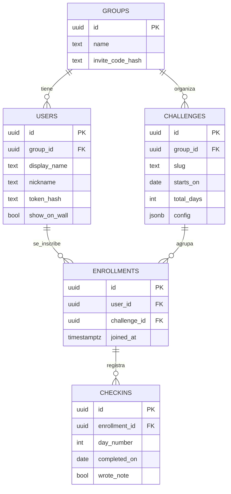
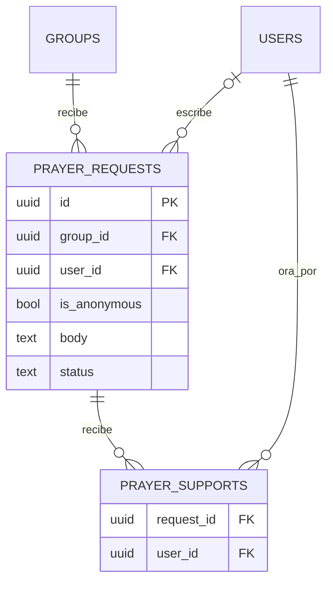

# 04 · Base de datos

Postgres en Supabase. Arquitectura, privacidad y operación general: [00-arquitectura.md](00-arquitectura.md). Reglas que originan las restricciones: [02-reto-7-dias.md](02-reto-7-dias.md) y [03-api.md](03-api.md).

## 1. Principios

**Decidido**

| Decisión | Razón |
|---|---|
| **No existe tabla de rachas.** Se guardan los check-ins como hechos y la racha se deriva | Un contador guardado se desincroniza y no deja corregir errores. Recalcular es barato a esta escala |
| **Modelo de retos genérico** (`challenges`, `enrollments`, `checkins`) | Sirve a cualquier reto futuro sin cambiar el esquema |
| **El contenido de cada día vive en el front.** La base solo guarda estado | Los textos se corrigen sin migraciones ([02 §2](02-reto-7-dias.md)) |
| **Nunca se guarda el texto de las conversaciones ni la firma** | Dato íntimo/sensible ([00 §3](00-arquitectura.md)) |
| **De los tokens y los códigos de invitación solo se guardan hashes** | Un volcado o filtración no permite hacerse pasar por nadie |

## 2. Diagrama entidad-relación

### Primer lanzamiento

### Posterior: peticiones de oración (funcionalidad aparte, ver [05](05-peticiones-de-oracion.md))

Estas tablas **no pertenecen al reto** ni forman parte del primer lanzamiento. Se muestran aparte para que se vea que solo se conectan a `groups` y `users`, no a `challenges`, `enrollments` ni `checkins`.

## 3. Tablas

Las columnas de la columna «Acordado» son las de la estructura definida. La columna «Sugerido» son añadidos recomendados, que se pueden omitir.

| Tabla | Acordado | Sugerido |
|---|---|---|
| `groups` | `id`, `name`, `invite_code_hash`. Permite más de un grupo de conexión en el futuro | `created_at` |
| `users` | `id`, `group_id`, `display_name`, `nickname` (único dentro del grupo), `token_hash`, `show_on_wall` | `created_at` |
| `challenges` | `id`, `group_id`, `slug`, `starts_on`, `total_days`, `config` (jsonb, para lo particular de cada tipo de reto) | `created_at` |
| `enrollments` | `id`, `user_id`, `challenge_id`, `joined_at`. Una inscripción por persona y reto | |
| `checkins` | `id`, `enrollment_id`, `day_number`, `completed_on`, `wrote_note`. Único por inscripción y número de día | `created_at` (cuándo se marcó, con hora) |
| `prayer_requests` *(posterior)* | `id`, `group_id`, `user_id`, `is_anonymous`, `body`, `status` | `created_at` (necesario para límite por día y orden) |
| `prayer_supports` *(posterior)* | `request_id`, `user_id`. El «estoy orando por ti» | |

### Qué guarda `config` *(abierto)*

`config` es para lo propio de cada tipo de reto. Candidatos razonables, **ninguno decidido**: el umbral de la racha del grupo, el tamaño de la ventana de ponerse al día (hoy 1 día). Si no se fija con claridad qué va aquí, el riesgo es que se convierta en un cajón de sastre: conviene documentar sus claves en el repositorio.

## 4. Restricciones e índices que se desprenden de las reglas

| Regla | Mecanismo |
|---|---|
| Nickname único dentro del grupo (sin distinguir mayúsculas) | Índice único sobre `(group_id, lower(nickname))` |
| Autenticar por token con una búsqueda | `users.token_hash` **único** (sirve también de índice) |
| Buscar el grupo por código | `groups.invite_code_hash` único |
| Un reto por grupo y slug | Único `(group_id, slug)` |
| Una inscripción por persona y reto | Único `(user_id, challenge_id)` |
| **Un check-in por inscripción y día** | Único `(enrollment_id, day_number)` — hace seguros los reintentos y las dobles pulsaciones |
| Día dentro de rango | `CHECK (day_number >= 1)`; el límite superior (`total_days`) depende de otra tabla, así que lo valida la API (o un trigger, si se quiere doble protección) |
| `total_days` positivo | `CHECK (total_days > 0)` |
| Muro por defecto visible | `show_on_wall boolean NOT NULL DEFAULT true` |
| Consultas del muro y del río | Índice en `enrollments(challenge_id)` y en `checkins(enrollment_id)` (este último ya lo cubre el único compuesto) |
| Formato de nickname y nombre | Validación en la API; en la base, `CHECK` de longitud como red de seguridad |
| Borrado de cuenta | `ON DELETE CASCADE` desde `users` hacia `enrollments` y desde estas hacia `checkins`; un borrado de usuario limpia todo |
| Borrado de grupo/reto | Cascada hacia abajo; **recomendado** proteger esas tablas del borrado accidental (solo se tocan por migración) |

Los tipos `uuid` con `gen_random_uuid()` como valor por defecto, `timestamptz` para instantes y `date` para días de calendario. `starts_on` y `completed_on` son `date` en la zona de Bogotá: la API las calcula, la base no las interpreta.

## 5. Peticiones de oración (posterior)

Estas decisiones aplican cuando se construya la funcionalidad ([05](05-peticiones-de-oracion.md)); se dejan aquí porque definen tablas.

| Decisión | Detalle |
|---|---|
| **«Anónima» = anónima para el grupo** | Así debe decirse en pantalla. La base **conoce** al autor |
| **Recomendado: guardar el autor** (`user_id`) aunque sea anónima | Permite que la persona borre su petición y permite manejar abusos |
| **Alternativa: anonimato total** (sin autor en la base) | Pierde esas dos cosas: nadie puede borrar su petición ni se puede identificar abuso. Requiere `user_id` nullable |
| **Abierto** | **La decisión entre ambas es abierta** (pregunta 5 del README) |
| Recomendado | Moderación por líderes; límite de caracteres y de publicaciones por día; un **contador** de «estoy orando» en lugar de comentarios; definir **quién revisa las peticiones delicadas** |

Si se decide anonimato total, `prayer_requests.user_id` debe ser `NULL` siempre para anónimas (o para todas) y `ON DELETE` no puede ser cascada para anónimas porque ya no habrá a quién enlazar.

`status` no tiene valores definidos: candidatos (propuesta, no decisión) activa / oculta por líder / archivada. Se resuelve al diseñar la moderación.

## 6. Migraciones

**Decidido:** versionadas en el repositorio.

**Recomendado**

- Carpeta `backend/migrations/`, un archivo SQL numerado por cambio (`0001_init.sql`, `0002_...`), nunca editar uno ya aplicado: se agrega uno nuevo.
- Una herramienta pequeña que lleve el registro de versiones (por ejemplo `goose` o `golang-migrate`); la elección es abierta y sin consecuencias grandes.
- Mismas migraciones en el Postgres local y en Supabase. Aplicarlas manualmente al inicio es suficiente; automatizarlas en CI es una mejora.
- Los datos iniciales (primer grupo y reto) se siembran con un script, no con una migración, porque contienen el hash de un código secreto.
- Las tablas de peticiones van en una migración posterior, no en la inicial: así el primer lanzamiento no arrastra tablas sin uso.

**Abierto:** herramienta de migraciones concreta.

## 7. Notas de operación

(Detalle y razones en [00 §4](00-arquitectura.md).)

| Tema | Nota |
|---|---|
| **Pausa por inactividad** | Supabase pausa el proyecto tras 7 días sin peticiones a la base. Un cron (GitHub Action) llama cada 2–3 días a `GET /v1/health`, que ejecuta una consulta |
| **Backups** | Son nuestros: `pg_dump` programado. El volcado contiene nombres y nicknames → guardarlo en privado y con retención corta; probar restaurar |
| **Pooler** | La API se conecta por el pooler de Supabase. Con el modo transacción, evitar sentencias preparadas persistentes en el driver. Migraciones y volcados: modo sesión |
| **Zona geográfica** | Base y API en la misma zona |
| **Esquema expuesto** | Activar RLS en todas las tablas sin políticas (o desactivar la API automática de Supabase): el front nunca debe consultar la base |
| **Desarrollo** | Postgres local, mismas migraciones. No se crea otro proyecto de Supabase |
| **Tamaño** | ~50 personas × pocos check-ins: la base es diminuta; el límite relevante no es almacenamiento sino la pausa por inactividad |

## 8. Fuera de alcance por ahora

- Tabla de rachas, vistas materializadas o cachés de rachas.
- Tabla para «enviar ánimo» (no está en la estructura acordada; hay que definirla cuando se aborde).
- Tabla de códigos de recuperación.
- Auditoría de moderación, historial de cambios.
- Almacenar contenido de conversaciones, firmas o archivos.
- Réplicas, particionado, multi-región.
